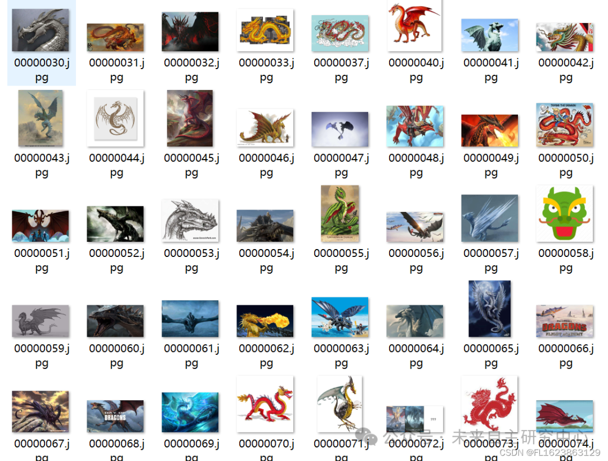

# [Dataset] [Image Classification] 12 Zodiac Signs Classification Dataset with 8492 Images in 12 Categories

Dataset Type: Image Classification, Not for Object Detection Unlabeled Files
Dataset Format: Only contains jpg images, each category folder contains the corresponding image.
Number of Images (JPG File Count): 8492
Number of Categories: 12
Category Names: ["dog", "dragon", "goat", "horse", "monkey", "ox", "pig", "rabbit", "ratt", "rooster", "snake", "tiger"]
Image Count per Category:
dog: 709
dragon: 702
goat: 709
horse: 710
monkey: 708
ox: 704
pig: 707
rabbit: 709
ratt: 710
rooster: 709
snake: 706
tiger: 709

Important Notice: No
Special Declaration: This dataset does not guarantee the accuracy of the trained models or weight files, and only provides accurate and reasonable classification storage.

Image example:

Below are the details about our services. If you have any needs, feel free to contact us through the WeChat public account. We will be happy to serve you. Our contact information is provided in the WeChat public account and can be easily found at any time.

The services we can provide include the following but are not limited to the following areas:

## Payment

Here is a pay link on Stripe ( https://buy.stripe.com/3cs8yP7sY87d0vu9AB ). Please contact me lonlonago@foxmail.com after funding $89, and I will send you a complete data files , thank you!

